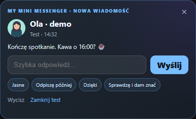
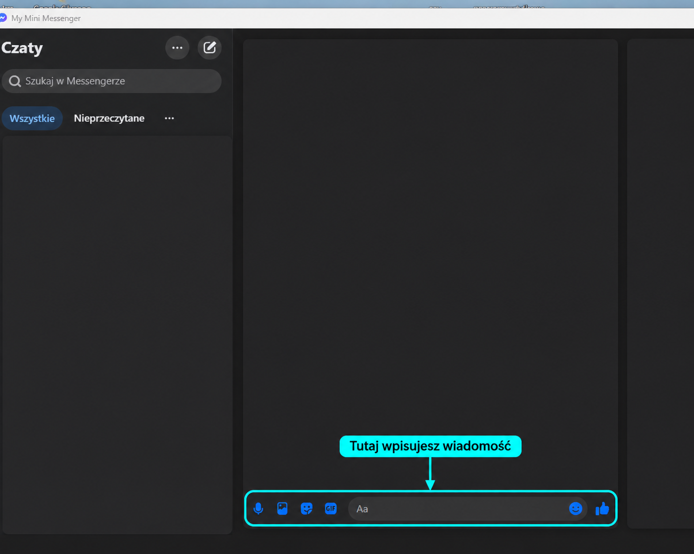
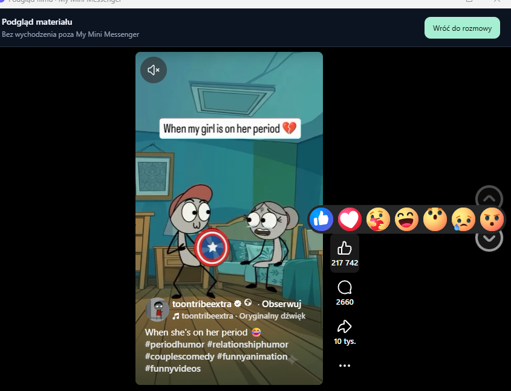

# My Mini Messenger

**Nieoficjalny klient Messengera na Windows. Prowadź rozmowy w osobnym oknie albo odpisuj szybko z dymka powiadomienia.**

[Zobacz demo (26 s, MP4)](assets/demo-pl.mp4) · [Centrum powiadomień](assets/center-pl.png)

## Jak to działa

- **Pełne rozmowy.** Otwórz Messengera w osobnym oknie, czytaj wiadomości i odpisuj tak jak w desktopowej aplikacji Messenger.
- **Podgląd filmów.** Otwieraj wybrane filmy udostępnione w rozmowie w osobnym oknie podglądu. Dostępność odtwarzania zależy od serwisu i konkretnego materiału.
- **Szybka odpowiedź.** Nowa wiadomość pojawia się w rogu ekranu. Możesz wpisać odpowiedź, wybrać gotowy tekst albo otworzyć rozmowę.
- **Centrum powiadomień.** Wiadomości od różnych osób trafiają do jednego miejsca. Możesz przejrzeć historię, zobaczyć podgląd multimediów i dopisać lokalną notatkę do rozmowy.
- **Tryb prywatny.** Rozmywa treść i multimedia w powiadomieniach, gdy udostępniasz ekran.

### Okno rozmowy

Wpisz wiadomość w dolnym polu, tak jak w Messengerze. Na ilustracji dane rozmów zostały zasłonięte, a pole odpowiedzi zaznaczone.

### Podgląd filmu

Wybrane filmy z rozmów możesz otworzyć i odtworzyć w oknie podglądu.

## Od usterki do poprawki

Po wpisaniu hasła formularz logowania potrafił utknąć na animacji ładowania. Diagnostyka wskazała, że filtr blokujący wyjście z Messengera odcinał też etap weryfikacji dwuetapowej. Dopuściłem konkretną ścieżkę weryfikacji, sprawdziłem reguły w testach automatycznych i potwierdziłem logowanie w aplikacji na Windows.

**Technologie** · Rust, Tauri 2, JavaScript i WebView2. Testy automatyczne obejmują między innymi reguły nawigacji i zachowanie interfejsu powiadomień.

**Stan projektu** · Beta 0.2.8 dla Windows x64, interfejs po polsku i angielsku. Demo pokazuje interfejs na fikcyjnych danych z symulowanym wysyłaniem odpowiedzi.

## English

My Mini Messenger is an unofficial Windows desktop client for Messenger. Open conversations and reply in a dedicated window, or reply directly from a small notification. Open selected shared videos in a separate preview window, subject to availability. A local notification center collects messages, media previews and conversation notes. Built with Rust, Tauri 2, JavaScript and WebView2. The [26-second demo](assets/demo-pl.mp4) shows the Polish interface with fictional messages and simulated replies.

---

Projekt portfolio autorstwa [PendulumPL](https://github.com/PendulumPL). Niezależny od Meta Platforms. Nazwa i znak Messenger należą do ich właściciela.
